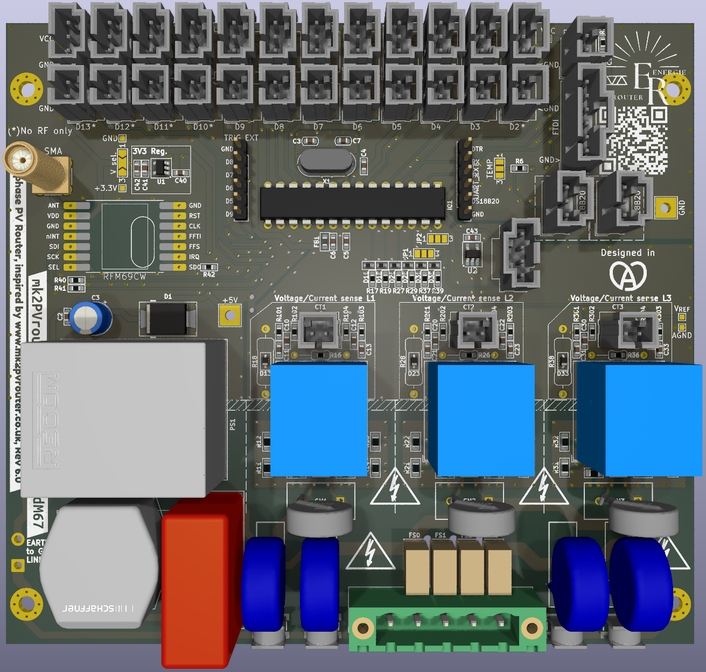
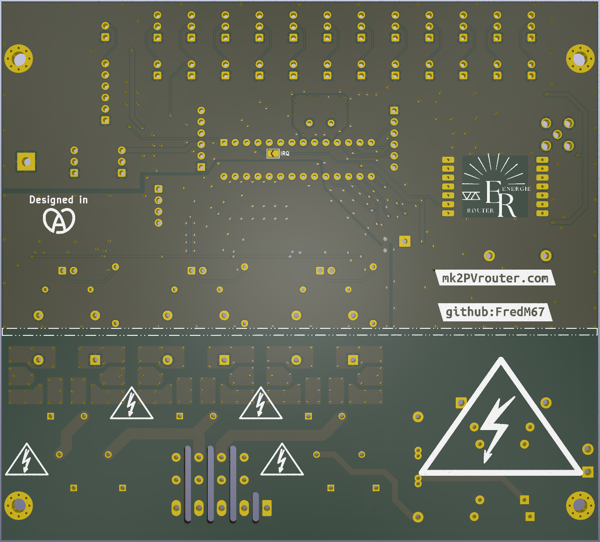
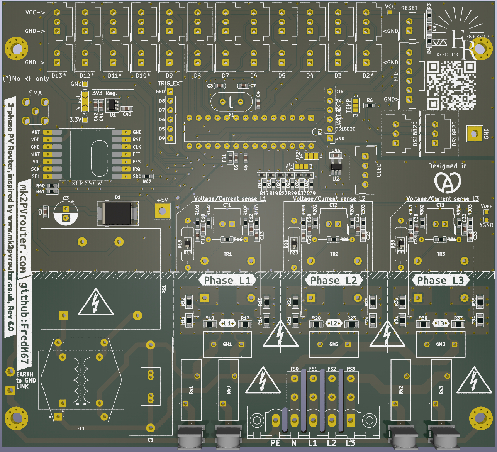
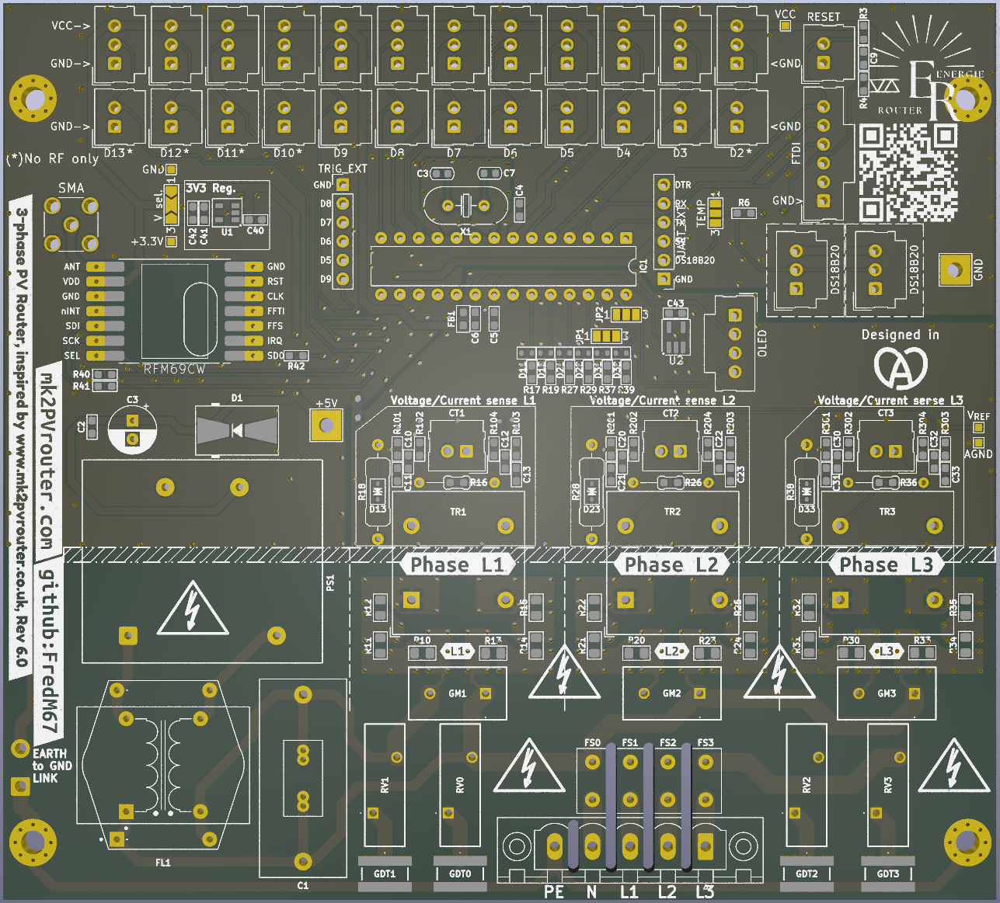

Français | **[English](Readme.en.md)**

# 3phaseDiverter — Carte principale universelle du Mk2 PV Router

Carte principale universelle pour le Mk2 PV Router (rév. 6.0). Elle prend en charge les configurations monophasé et triphasé (avec ou sans neutre).

## Présentation

La carte 3phaseDiverter est le cœur du système Mk2 PV Router — un routeur solaire photovoltaïque open source capable de piloter jusqu'à trois charges selon la production solaire excédentaire. Elle est conçue pour être installée dans un boîtier Schneider Electric Thalassa.

Caractéristiques principales :
- Microcontrôleur **ATmega328P** (16 MHz, DIP-28)
- Jusqu'à 3 capteurs de tension (transformateurs **ZMPT101K**, rapport 1000:1000)
- Jusqu'à 3 transformateurs de courant (connecteurs **CT1–CT3**)
- Module radio **RFM69CW** (bande ISM 433/868 MHz) avec connecteur SMA
- Alimentation AC-DC intégrée (**Multicomp Pro MPC10-5**, 5 V / 10 W)
- Régulateur LDO **AP7361C-33E** (5 V → 3,3 V, 1 A)
- Protection contre les surtensions : fusibles, varistances hybrides IsoMOV entre phase et neutre, self de mode commun ; en option, paires varistance + éclateur GDT vers la terre
- Buffer de la référence interne 1,1 V (AREF) par amplificateur opérationnel **LMV321A**, polarisation des voies à VREF/2
- Connecteurs d'extension : **TRIG_EXT**, **UART_EXT**, **FTDI**, **OLED**
- Conception conforme IPC-2221 pour 230 V RMS / 325 V crête sur FR4 non revêtu

## Images de la carte

| Face avant (assemblée) | Face arrière |
|:-:|:-:|
|  |  |

| Composants CMS uniquement | Circuit imprimé nu |
|:-:|:-:|
|  |  |

## Schéma

[](assets/3phaseDiverter-schematic.pdf)

## Fichiers de conception

| Fichier | Description |
|---------|-------------|
| `3phaseDiverter.kicad_pro` | Fichier projet KiCad 9 |
| `3phaseDiverter.kicad_sch` | Schéma |
| `3phaseDiverter.kicad_pcb` | Circuit imprimé |
| `3phaseDiverter.kicad_dru` | Règles de conception |
| `UserDef.kicad_sym` | Bibliothèque de symboles locale |
| `sym-lib-table` | Table des bibliothèques de symboles |
| `fp-lib-table` | Table des bibliothèques d'empreintes |

## Nomenclature (BOM)

### Circuits intégrés et modules

| Réf | Valeur | Boîtier | Description |
|-----|--------|---------|-------------|
| IC1 | ATmega328P | DIP-28 | Microcontrôleur (16 MHz) |
| U2 | LMV321A | SOT-23-5 | Amplificateur opérationnel simple (buffer AREF 1,1 V) |
| U1 | AP7361C-33E | SOT-223 | Régulateur LDO 3,3 V (1 A) |
| PS1 | MPC10-5 | Converter_ACDC_MULTICOMP_PRO | Module d'alimentation AC-DC (5 V, 10 W, Multicomp Pro) |
| RF1 | RFM69CW | Custom | Module radio ISM (433/868 MHz) |

### Capteurs de tension

| Réf | Valeur | Boîtier | Description |
|-----|--------|---------|-------------|
| TR1 | ZMPT101K | Custom | Transformateur de tension L1 (1000:1000) |
| TR2 | ZMPT101K | Custom | Transformateur de tension L2 (1000:1000) |
| TR3 | ZMPT101K | Custom | Transformateur de tension L3 (1000:1000) |

### Protection

| Réf | Valeur | Boîtier | Description |
|-----|--------|---------|-------------|
| FS0–FS3 | 1 A × 250 V | Traversant (empreinte Littelfuse série 395), soudé, sans porte-fusible | Fusibles (4×, un par phase + neutre) |
| GM1–GM3 | 320 V | Traversant (IsoM3300BL2) | Varistances hybrides (MOV + GDT dans un même boîtier), entre phase et neutre (3×) |
| RV0–RV3 | 300 V | Traversant, radial (MOV14D471K) | Varistances, chacune en série avec l’éclateur de même numéro, entre un conducteur et la terre (4×, **optionnelles**) |
| GDT0–GDT3 | 2093-300-SM-RPLF | CMS | Éclateurs à gaz, en série avec RV0–RV3 (4×, **optionnels**, soudés par l’utilisateur) |
| FL1 | RN214-0.3-02-47M | Traversant (Schaffner RNx14) | Self de mode commun en amont de PS1 |
| D1 | SMBJ7.0A | SMB | Diode TVS sur le rail 5 V |
| D11 / D21 / D31 | DF2B7AE | SOD-523 | Diodes TVS sur les entrées ADC tension (A0, A2, A4') |
| D12 / D22 / D32 | DF2B7AE | SOD-523 | Diodes TVS sur les entrées ADC courant (A1, A3, A5') |
| D13 / D23 / D33 | CDSOD323-T03C | SOD-323, empreinte avec deux trous traversants (pas de 12,70 mm) | Diodes TVS bidirectionnelles aux bornes des entrées CT ; les deux trous reçoivent la résistance de charge axiale d’un CT à sortie courant |

Les RVx et GDTx ne fonctionnent que par paire : la varistance et l’éclateur sont en série entre un conducteur et la terre.

### Connecteurs

| Réf (sérigraphie) | Valeur | Boîtier | Description |
|-------------------|--------|---------|-------------|
| PWR1 | Conn_01x05_PWR | Phoenix Contact MSTBV 2,5 | Entrée secteur (1×5, pas 5,08 mm) |
| TRIG_EXT0 (TRIG_EXT) | Conn_01x06 | Barrette mâle 1×06 2,54 mm | Connecteur déclenchement/GPIO (mk2Wifi) |
| JP8 (UART_EXT) | Conn_01x06 | Barrette mâle 1×06 2,54 mm | Connecteur UART + DS18B20 (mk2Wifi) |
| J0 (FTDI) | FTDI | Molex SL 1×06 2,54 mm | Connecteur programmation/débogage |
| J1 (RESET) | RESET | Molex SL 1×02 2,54 mm | Bouton de réinitialisation (GND, /DTR) |
| J31 (OLED) | OLED | Molex SL 1×04 2,54 mm | Connecteur écran I2C |
| J32, J33 (DS18B20) | DS18B20 | Molex SL 1×03 2,54 mm | Sondes de température (GND, données, +5 V) |
| J2–J13 (D2–D13) | – | Molex SL 1×03 2,54 mm | Broches numériques : GND, Dx, +5 V (seulement si JP40 est fermé) |
| J16–J27 (D2–D13) | – | Molex SL 1×02 2,54 mm | Broches numériques : GND, Dx |
| CT1–CT3 | Conn_01x02 | Molex SL 1×02 2,54 mm | Entrées transformateurs de courant (L1, L2, L3) |
| CN1 | SMA | Amphenol 132291-12, vertical | Connecteur antenne RF 50 Ω |

### Passifs — blocs par phase (×3)

Chaque phase (L1/L2/L3) possède un ensemble identique de composants. La numérotation suit le schéma 1xx = L1, 2xx = L2, 3xx = L3.

| Réf (L1 / L2 / L3) | Valeur | Boîtier | Description |
|----------------------|--------|---------|-------------|
| R10–R15 / R20–R25 / R30–R35 | 20K | 1206 | Résistances série primaire ZMPT101K (6× en série par phase, conversion tension secteur → ~2 mA) |
| R16 / R26 / R36 | 150R | CMS 0603 ou traversant (empreinte R_PTH_SMD) | Résistance de charge ZMPT101K (conversion courant 2 mA → tension) ; l’empreinte mixte accepte une seconde résistance en parallèle |
| R17 / R27 / R37 | 1K | 0603 | Résistance série vers l’entrée ADC tension (A0, A2, A4') |
| R19 / R29 / R39 | 1K | 0603 | Résistance série vers l’entrée ADC courant (A1, A3, A5') |
| R18 / R28 / R38 (schéma seulement) | selon le CT | Axiale, dans les deux trous traversants de l’empreinte de D13 / D23 / D33 | Résistance de charge d’un CT à sortie courant ; non montée, soudée par l’utilisateur si besoin |
| R101–R104 / R201–R204 / R301–R304 | 10K | 0603 | Diviseurs 50/50 pour polarisation à VREF/2 (1 paire par voie V et I) |
| C10 / C20 / C30 | 10 µF | 0603 | Couplage AC série, voie tension (entre charge ZMPT101K et point de polarisation V — bloque le continu, passe le signal alternatif) |
| C12 / C22 / C32 | 10 µF | 0603 | Couplage AC série, voie courant (entre CT et point de polarisation I — bloque le continu, passe le signal alternatif) |
| C11, C13 / C21, C23 / C31, C33 | 100 nF | 0603 | Condensateurs de découplage, point de polarisation vers AGND (C11/C21/C31 tension, C13/C23/C33 courant) |
| D11, D12 / D21, D22 / D31, D32 | DF2B7AE | SOD-523 | Diodes TVS sur les entrées ADC (D11/D21/D31 tension, D12/D22/D32 courant) |
| D13 / D23 / D33 | CDSOD323-T03C | SOD-323 + 2 trous traversants | Diode TVS bidirectionnelle aux bornes de l’entrée CT ; les trous reçoivent la résistance de charge |

### Passifs — composants communs

| Réf | Valeur | Boîtier | Description |
|-----|--------|---------|-------------|
| C1 | 1 µF 310 VAC | Film, traversant | Condensateur X2 entre L1 et neutre, en amont de FL1 |
| C3 | 220 µF 16 V | Électrolytique CMS 6,3×7,7 | Filtrage de la sortie 5 V |
| C2, C40 | 1 µF | 0603 | Filtrage 5 V |
| C41 | 4,7 µF | 0603 | Filtrage de la sortie de U1 |
| C42 | 100 nF | 0603 | Découplage de la sortie de U1 |
| C44 | 10 µF | 0603 | Filtrage de VCC (réseau +3.3V) |
| C4 | 100 nF | 0603 | Découplage de VCC |
| C6, C43 | 100 nF | 0603 | Découplage d’AVCC |
| C5 | 100 nF | 0603 | Découplage d’AREF |
| C45 | 100 nF | 0603 | Découplage de l’alimentation du RFM69CW (après FB2) |
| C9 | 100 nF | 0603 | Couplage /DTR → RESET (réinitialisation automatique) |
| C7, C8 | 22 pF | 0603 | Condensateurs de charge quartz |
| X1 | 16 MHz | HC-49/U, traversant | Quartz |
| R3 | 1M | 0603 | Pull-up /DTR |
| R4 | 47K | 0603 | Pull-up RESET |
| R6 | 4,7K | 0603 | Pull-up DS18B20 |
| R40–R42 | 22R | 0603 | Résistances série SPI (vers le RFM69CW) |
| R43 | 2K2 | 0603 | Résistance de LED40 |
| R44 | 4K7 | 0603 | Résistance de LED41 |
| R45 | 47K | 0603 | Pull-up NSS du RFM69CW |
| FB1 | Ferrite | 0603 | Filtrage VCC → AVCC |
| FB2 | Ferrite | 0603 | Filtrage VCC → alimentation du RFM69CW |
| LED40 | ON | 0603 | Présence de VCC |
| LED41 | +5V | 0603 | Présence du +5 V sur la broche 3 de J2–J13 (JP40 fermé) |

### Configuration

| Réf (sérigraphie) | Type | Description |
|-------------------|------|-------------|
| JP0 (V sel.) | SolderJumper 3 pôles | Alimentation de l’ATmega328P (VCC) : 3,3 V de U1 (usine) ou 5 V |
| JP1 (SDA) | SolderJumper 3 pôles | Sélection A4 : mesure tension L3 ou I2C SDA |
| JP2 (SCL) | SolderJumper 3 pôles | Sélection A5 : mesure courant L3 ou I2C SCL |
| JP3 (IRQ) | SolderJumper 2 pôles | Relie l’interruption du RFM69CW à D2 (à fermer si le module RF est utilisé) |
| JP4 (TEMP) | SolderJumper 3 pôles | DS18B20 géré par le routeur (D3) ou par le module mk2Wifi |
| JP40 (+5V Rail) | SolderJumper 2 pôles | Amène le +5 V sur la broche 3 des connecteurs numériques J2–J13 |
| JP41 (NSS) | SolderJumper 2 pôles | Relie la sélection du RFM69CW à D10 (à fermer si le module RF est utilisé) |
| GND_LINK1 (GND_LINK) | Cavalier fil 0,75 mm² | Relie la masse basse tension (GND) à la terre de protection (ouvert par défaut) |
| NT0 | Net tie | Liaison permanente GND–AGND |

### Points de test

| Réf | Réseau |
|-----|--------|
| TP2 | VREF |
| TP3 | VCC (réseau +3.3V, alimentation de l’ATmega328P) |
| TP41 | Sortie de U1 (3,3 V) |
| TP4 | +5V |
| TP5, TP42 | GND |

### Montage

| Réf | Description |
|-----|-------------|
| H1–H4 | Trous de fixation avec pastilles |

## Brochage des connecteurs

### PWR1 — Entrée secteur (1×5 Phoenix Contact)

| Broche | Signal |
|--------|--------|
| 1 | Terre |
| 2 | Neutre |
| 3 | L1 |
| 4 | L2 |
| 5 | L3 |

En monophasé, un connecteur 3 voies est fourni (Terre, Neutre, L1).

### TRIG_EXT — Déclenchement/GPIO (1×6 barrette mâle)

| Broche | Signal |
|--------|--------|
| 1 | GND |
| 2 | D8 |
| 3 | D7 |
| 4 | D6 |
| 5 | D5 |
| 6 | D9 |

### UART_EXT — UART + DS18B20 (1×6 barrette mâle)

| Broche | Signal |
|--------|--------|
| 1 | GND |
| 2 | DS18B20 |
| 3 | +5 V |
| 4 | RX |
| 5 | TX |
| 6 | DTR |

Les noms des signaux (TX, RX) sont du point de vue de la **carte principale** : TX transporte les données émises par l'ATmega328P, RX les données reçues.

### FTDI — Programmation/débogage (1×6 Molex SL)

| Broche | Signal |
|--------|--------|
| 1 | GND |
| 2 | CTS (NC) |
| 3 | VCC (NC) |
| 4 | TXO |
| 5 | RXI |
| 6 | DTR |

Brochage compatible avec les adaptateurs FTDI standard. TXO (données de l'adaptateur vers le MCU) est relié au réseau RX. RXI (données du MCU vers l'adaptateur) est relié au réseau TX. Le signal DTR permet l'auto-reset pour le téléversement via le bootloader Arduino.

### OLED — Écran I2C (1×4 Molex SL)

| Broche | Signal |
|--------|--------|
| 1 | GND |
| 2 | AVCC |
| 3 | SCL |
| 4 | SDA |

Le bus I2C est partagé sur les broches A4 (SDA) et A5 (SCL) de l'ATmega328P. En mode triphasé, ces broches sont affectées à la mesure de tension/courant L3 — l'écran OLED n'est alors pas disponible. Le choix est effectué par les cavaliers **JP1** et **JP2**.

### CT1 / CT2 / CT3 — Transformateurs de courant (1×2 Molex SL)

| Broche | Signal |
|--------|--------|
| 1 | Signal CT |
| 2 | AGND |

CT1 est utilisé en monophasé et en triphasé. En triphasé, CT2 et CT3 mesurent L2 et L3. En monophasé, CT2 (A3) reste entièrement utilisable, par exemple pour mesurer le courant routé ; CT3 n’est pas disponible quand JP2 relie A5 à I2C SCL.

### CN1 — Antenne RF (SMA)

Connecteur SMA femelle vertical (Amphenol 132291-12) pour antenne 50 Ω. Relié au module RFM69CW par une piste d'environ 8 mm. La piste est courte, ce qui rend l'adaptation d'impédance non critique.

## Affectation des broches de l'ATmega328P

### Entrées analogiques

| Broche Arduino | Port | Fonction | Notes |
|----------------|------|----------|-------|
| A0 | PC0 | Mesure de tension L1 | Via diviseur résistif + ZMPT101K |
| A1 | PC1 | Mesure de courant L1 | Via CT1 |
| A2 | PC2 | Mesure de tension L2 | Via diviseur résistif + ZMPT101K |
| A3 | PC3 | Mesure de courant L2 | Via CT2 |
| A4 | PC4 | Mesure de tension L3 / I2C SDA | Sélection par JP1 |
| A5 | PC5 | Mesure de courant L3 / I2C SCL | Sélection par JP2 |

### Sorties numériques et communication

| Broche Arduino | Port | Fonction | Notes |
|----------------|------|----------|-------|
| D0 | PD0 | UART RX | Réception série (FTDI, UART_EXT) |
| D1 | PD1 | UART TX | Émission série (FTDI, UART_EXT) |
| D2 | PD2 | Interruption RFM69CW | INT0, via JP3 |
| D3 | PD3 | DS18B20 (1-Wire) | Capteur de température, si JP4 en position routeur |
| D4 | PD4 | Entrée numérique | Usage général |
| D5 | PD5 | Sortie déclenchement | TRIG_EXT broche 5 |
| D6 | PD6 | Sortie déclenchement | TRIG_EXT broche 4 |
| D7 | PD7 | Sortie déclenchement | TRIG_EXT broche 3 |
| D8 | PB0 | Sortie déclenchement | TRIG_EXT broche 2 |
| D9 | PB1 | Sortie déclenchement | TRIG_EXT broche 6 |
| D10 | PB2 | SPI SS | Sélection du RFM69CW, via JP41 |
| D11 | PB3 | SPI MOSI | Données vers RFM69CW |
| D12 | PB4 | SPI MISO | Données depuis RFM69CW |
| D13 | PB5 | SPI SCK | Horloge SPI |

## Alimentation

### Chaîne d'alimentation

Le secteur entre par le connecteur **PWR1** :

```
PWR1 → Fusibles (FS0–FS3), un par conducteur
     → GM1–GM3 entre chaque phase et le neutre
     → en option, paires RVx + GDTx entre chaque conducteur et la terre
     → C1 (X2) entre L1 et neutre → Self de mode commun (FL1)
     → PS1 (MPC10-5) : 230 VAC → 5 VDC, 10 W
     → rail +5 V (C2, C3, C40 ; diode TVS D1 SMBJ7.0A)
     → U1 (AP7361C-33E) : 5 V → 3,3 V
     → JP0 (V sel.) : VCC = sortie de U1 (usine) ou +5 V
```

Les branches de mesure de tension (L1/L2/L3_SENSING) partent après les fusibles.

### Rails d'alimentation

| Rail | Tension | Usage |
|------|---------|-------|
| +5 V | 5 V | Sortie de PS1 ; UART_EXT broche 3 (mk2Wifi), connecteurs DS18B20, broche 3 de J2–J13 via JP40, entrée de U1 |
| Sortie de U1 | 3,3 V | Alimente VCC via JP0 (position usine) ; TP41 |
| VCC (réseau +3.3V) | 3,3 V (5 V si JP0 est déplacé) | ATmega328P, RFM69CW (via FB2), pull-ups, LED40 |
| AVCC | VCC filtré par FB1 | AVCC de l’ATmega328P, LMV321A, connecteur OLED |
| VREF | 1,1 V | Référence interne (AREF) bufferisée par le LMV321A |
| GND | 0 V | Masse |
| AGND | 0 V | Masse analogique, reliée à GND par le net tie NT0 |
| Terre | – | Terre de protection (PWR1 broche 1) ; reliée à GND seulement si GND_LINK est fermé |

### Découplage

- C1 (1 µF 310 VAC, X2) : filtrage côté secteur, entre L1 et neutre
- C3 (220 µF), C2, C40 (1 µF) : filtrage 5 V
- C41 (4,7 µF), C42 (100 nF) : sortie de U1
- C44 (10 µF), C4 (100 nF) : VCC
- C6, C43 (100 nF) : AVCC ; C5 (100 nF) : AREF
- C45 (100 nF) : alimentation du RFM69CW
- C7, C8 (22 pF) : condensateurs de charge du quartz X1
- FB1, FB2 (ferrites) : filtrage d’AVCC et de l’alimentation du RFM69CW

## Dissipation des résistances

La tension de référence ADC est la référence interne 1,1 V de l'ATmega328P, bufferisée par le LMV321A. La plage ADC est donc 0–1,1 V, avec une polarisation au point milieu VREF/2 = 0,55 V.

### Chaîne primaire ZMPT101K (par phase : 6 × 20K = 120K en série)

| Tension secteur | Courant (RMS) | Puissance par résistance 20K | Total (6 résistances) | Taux d’utilisation 1206 (250 mW typ.) |
|-----------------|---------------|------------------------------|-----------------------|------------------------------------------|
| 110 V | 0,917 mA | 16,8 mW | 101 mW | 7 % |
| 230 V | 1,917 mA | **73,5 mW** | 441 mW | **29 %** |
| 250 V | 2,083 mA | 86,8 mW | 521 mW | 35 % |

À 230 V nominal, les trois phases dissipent 3 × 441 = **1,32 W** dans les chaînes de diviseurs.

### Résistance de charge ZMPT101K (R16 / R26 / R36 — 150 R)

Courant secondaire = courant primaire (rapport 1 : 1). À 230 V : I = 1,917 mA.
- P = (1,917 mA)² × 150 = **0,55 mW** — négligeable

### Résistance de charge CT (R18 / R28 / R38 au schéma — exemple 22 R)

La puissance dépend du calibre du CT.

**CT à sortie tension** (ex. : SCT-013-030, 30 A/1 V) : la résistance de charge est intégrée dans le CT. Aucune résistance de charge n’est montée. Dissipation : **négligeable**.

**CT à sortie courant** (ex. : SCT-013-000, 100 A/50 mA) : le courant secondaire traverse la résistance de charge, une résistance axiale soudée dans les deux trous traversants de l’empreinte de D13 / D23 / D33. La dissipation dépend du courant primaire mesuré :

| Courant primaire | I secondaire (100 A/50 mA) | P dans 22 R | Résistance axiale 0,5 W (taille DIN0309 de l’empreinte) |
|------------------|---------------------------------|---------------|------------------------|
| 20 A | 10 mA | 2,2 mW | < 1 % |
| 60 A | 30 mA | 19,8 mW | 4 % |
| 100 A | 50 mA | 55 mW | 11 % |

⚠️ **Avec un CT à sortie courant**, la valeur de la résistance de charge doit être choisie pour que la tension crête ne dépasse pas 0,55 V (demi-plage ADC à VREF = 1,1 V). Formule : **R = 0,55 V / I_sec_crête**. Avec 22 R, le courant crête max est de 25 mA. Les diodes TVS (DF2B7AE) protègent l’ADC mais ne limitent pas le courant dans la résistance de charge : si le CT délivre plus que prévu, la résistance peut surchauffer.

Dans les limites de la plage ADC :
- I_sec_max = 0,55 V / 22 R = 25 mA crête ≈ 17,7 mA RMS
- **P = (17,7 mA)² × 22 = 6,9 mW** — négligeable

### Diviseurs VREF/2 (R101–R104 / R201–R204 / R301–R304 — 10K)

Deux résistances de 10K en série entre VREF (1,1 V) et GND :
- I = 1,1 V / 20K = 55 µA
- **P par 10K = 30 µW** — négligeable

La valeur de 10K (impédance Thévenin 5K) respecte la recommandation du datasheet ATmega328P (≤ 10K d’impédance source pour le condensateur S/H de 14 pF de l’ADC). Un condensateur de découplage de 100 nF (C11/C13 par phase) entre le point de polarisation et AGND filtre le bruit haute fréquence sans atténuer le signal à 50 Hz.

### Autres résistances

| Réf | Valeur | Tension | Courant | Puissance |
|-----|--------|---------|---------|-----------|
| R3 | 1M | 3,3 V | 3,3 µA | 0,011 mW |
| R4 | 47K | 3,3 V | 70 µA | 0,23 mW |
| R6 | 4,7K | 3,3 V | 0,70 mA | 2,3 mW |
| R17 / R27 / R37 | 1K | < 2 V | < 2 mA | < 4 mW |
| R19 / R29 / R39 | 1K | < 1 V | < 1 mA | < 1 mW |
| R40–R42 | 22R | 3,3 V | signal | < 5 mW |

Toutes les résistances hors chaîne primaire ZMPT101K dissipent moins de 5 mW. Seules les **R10–R15 / R20–R25 / R30–R35** présentent une dissipation significative (73,5 mW chacune à 230 V, soit 29 % d’une résistance 1206 de 250 mW).

## Protection parafoudre

La carte implémente une protection multiniveau conforme aux normes IPC-2221 pour le fonctionnement à 230 V RMS sur FR4 non revêtu.

### Niveaux de protection

1. **Fusibles (FS0–FS3)** : 1 A × 250 V, un par phase et neutre, soudés directement (sans porte-fusible). Ils coupent en cas de court-circuit sur la carte, par exemple une varistance en fin de vie ou un défaut de PS1 ou de C1.
2. **Varistances hybrides (GM1–GM3)** : IsoMOV (MOV + GDT dans un même boîtier), 320 V, entre chaque phase et le neutre, après les fusibles.
3. **Paires optionnelles RVx + GDTx (RV0–RV3, GDT0–GDT3)** : pour une protection complète contre la foudre. Chaque varistance est en série avec l’éclateur de même numéro, entre un conducteur et la terre : RV0 + GDT0 sur le neutre, RV1 + GDT1 sur L1, RV2 + GDT2 sur L2, RV3 + GDT3 sur L3. Non montées par défaut ; l’utilisateur les soude, toujours par paire.
4. **Condensateur X2 (C1) et self de mode commun (FL1)** : filtrent l’alimentation de PS1.
5. **Diode TVS (D1, SMBJ7.0A)** : protection du rail 5 V en sortie du module d’alimentation.
6. **Diodes TVS des entrées ADC** : par phase, une DF2B7AE sur l’entrée tension (D11/D21/D31) et sur l’entrée courant (D12/D22/D32), et une CDSOD323-T03C aux bornes de l’entrée CT (D13/D23/D33).

### Domaines de tension et classes de réseau

La carte utilise plusieurs classes de réseau avec des règles d'isolement spécifiques :

| Classe | Domaine | Usage |
|--------|---------|-------|
| Surge | Secteur brut + transitoires | Broches PWR1, pastilles GDT, pastilles fusibles, Terre |
| HV | Secteur (après protection) | L1/L2/L3_VOLTAGE, NEUTRAL, PS1 côté AC |
| HV Divider | Points médians diviseurs | Réseau entre résistances HV et résistances de mesure |
| Power | 5 V / 3,3 V DC | +5 V, +3,3 V, GND, VCC |
| Low Power | Analogique / signal | VREF, AVCC, réseaux ampli-op |
| CT | Basse tension | Signaux transformateurs de courant |
| ANT | RF | Connecteur SMA vers module RFM69 (~8 mm de piste) |
| Gnd | Masse analogique | AGND |
| Default | Basse tension | Signaux généraux |

Les règles d'isolement HV sont définies dans `3phaseDiverter.kicad_dru`. L'isolement HV–LV est de 2,5 mm ; l'isolement HV–HV Divider est de 1,0 mm.

## Configuration

### Cavaliers de soudure

Voir le tableau [Configuration](#configuration) de la nomenclature : JP0 (V sel.), JP1 (SDA), JP2 (SCL), JP3 (IRQ), JP4 (TEMP), JP40 (+5V Rail), JP41 (NSS) et le cavalier fil GND_LINK (terre ↔ GND, fil 0,75 mm²).

### Monophasé vs triphasé

Tous les composants CMS sont assemblés en production, quelle que soit la configuration, sauf les éclateurs à gaz optionnels GDT0–GDT3. La sélection monophasé/triphasé se fait par les cavaliers de soudure et le choix des connecteurs.

En **monophasé**, les cavaliers JP1 et JP2 sont configurés en position I2C (SDA/SCL), ce qui permet l'utilisation de l'écran OLED : ils sont reliés d'usine aux lignes de mesure L3 du triphasé, il faut donc couper cette liaison et ponter le côté I2C. Un connecteur PWR1 3 voies est fourni (Terre, Neutre, L1). CT1 mesure le courant du réseau ; CT2 peut aussi être raccordé, son entrée étant entièrement câblée (le firmware monophasé s'en sert pour mesurer l'énergie routée).

En **triphasé**, les cavaliers JP1 et JP2 sont configurés pour les mesures L3 (position A4'/A5'), ce qui désactive l'afficheur OLED. Le connecteur PWR1 5 voies est utilisé et les trois CT sont raccordés.

## Intégration du module d'extension

La carte principale est conçue pour accueillir le module d'extension **mk2Wifi** via les connecteurs TRIG_EXT et UART_EXT :

- La carte principale utilise des **barrettes mâles** ; la mk2Wifi utilise des **barrettes femelles**
- L'alimentation +5 V est fournie par la carte principale via UART_EXT broche 3
- L'UART (TX/RX) assure la communication série avec le module d'extension
- Le signal DS18B20 est acheminé via UART_EXT broche 2 pour la mesure de température 1-Wire
- Les signaux GPIO D5–D9 fournissent les sorties de déclenchement/commande via TRIG_EXT
- Le bus I2C (SCL/SDA) est **local au module mk2Wifi uniquement** — il relie l'ESP32-C6 à l'écran OLED et n'est pas routé vers la carte principale

## Programmation

Le connecteur **FTDI** (Molex SL 1×6) permet le téléversement du firmware via un adaptateur USB-série FTDI ou compatible :

1. **Connexion** : brancher l'adaptateur FTDI sur le connecteur J0. Le brochage est compatible avec les câbles FTDI standard (GND sur la broche 1). La broche 3 (VCC) n’est pas connectée : l’adaptateur n’alimente pas la carte.
2. **Auto-reset** : le signal DTR déclenche un reset automatique de l'ATmega328P via un condensateur de couplage, permettant le téléversement sans intervention manuelle.
3. **Environnement** : compatible Arduino (ATmega328P avec bootloader). Utiliser la carte « Arduino Uno » ou équivalent dans l'IDE Arduino.

### Capteur de température DS18B20

Le capteur 1-Wire DS18B20 est toujours connecté sur la carte principale. Le cavalier **JP4** permet de choisir qui gère le capteur :
- **Position routeur** : le signal est acheminé vers la broche D3 de l'ATmega328P
- **Position mk2Wifi** : le signal est acheminé vers le module d'extension via UART_EXT broche 2

La résistance de pull-up nécessaire est intégrée sur la carte (R6, 4,7 kΩ).
